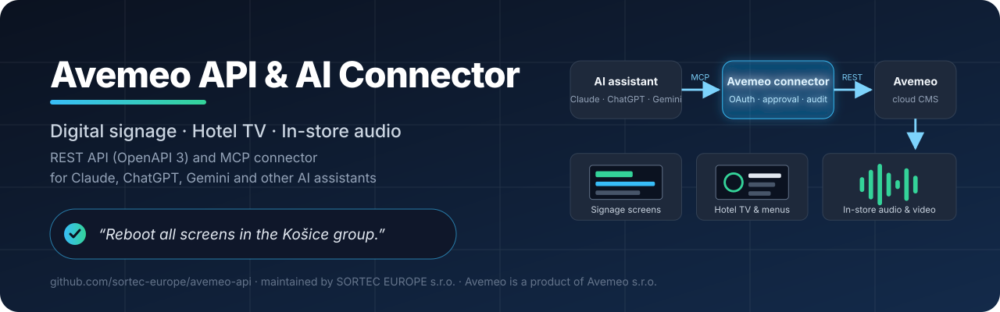
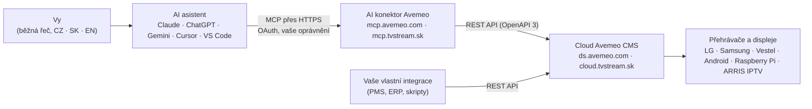

<!-- markdownlint-disable MD033 MD041 -->

  

# Avemeo API a AI konektor (MCP) – digital signage, hotelová TV a audio v prodejnách

**Avemeo** je cloudová platforma pro **digital signage (digitální obrazovky)**, **hotelovou TV (hotelová IPTV)** a **audio a video v prodejnách**. Tento repozitář je veřejným domovem **dokumentace Avemeo REST API** a **AI konektoru Avemeo** – vzdáleného serveru [Model Context Protocol (MCP)](https://modelcontextprotocol.io), přes který spravujete obrazovky, playlisty, časové plány a přehrávače běžnou řečí z **Claude, ChatGPT, Gemini** nebo jiného AI asistenta s podporou MCP.

  
  
  
  
  
  
  

> 🇬🇧 **English version:** [README.md](README.md) · 🇸🇰 **Slovenská verzia:** [README.sk.md](README.sk.md) · 📄 **Strojově čitelné shrnutí pro AI nástroje:** [llms.txt](llms.txt)

## Obsah

- [Ve zkratce](#ve-zkratce)
- [Pro koho je to určeno](#pro-koho-je-to-určeno)
- [Co je Avemeo](#co-je-avemeo)
- [Jak funguje AI konektor](#jak-funguje-ai-konektor)
- [Co můžete AI asistentovi napsat](#co-můžete-ai-asistentovi-napsat)
- [Funkce platformy](#funkce-platformy)
- [Podporované přehrávače a displeje](#podporované-přehrávače-a-displeje)
- [Rychlý start: REST API](#rychlý-start-rest-api)
- [Rychlý start: AI konektor (MCP)](#rychlý-start-ai-konektor-mcp)
- [Bezpečnost a kontrola](#bezpečnost-a-kontrola)
- [Stav a plán](#stav-a-plán)
- [Často kladené otázky](#často-kladené-otázky)
- [Dokumentace](#dokumentace)
- [Kontakt a pilotní program](#kontakt-a-pilotní-program)
- [O tomto repozitáři](#o-tomto-repozitáři)

## Ve zkratce

| | |
|---|---|
| **Produkt** | Avemeo – cloudový CMS pro digital signage, hotelovou TV a audio/video v prodejnách |
| **Cloudy** | Avemeo (`ds.avemeo.com`) · [Business Stream](https://www.telekom.sk/biznis/stredne-velke-firmy/business-stream) od Slovak Telekomu (`cloud.tvstream.sk`) |
| **REST API** | stejné API, které používá Avemeo CMS; technická dokumentace pro zákazníky a integrátory na vyžádání, připravuje se API v2 → [přehled API](docs/cs/api-overview.md) |
| **AI konektor (MCP)** | vzdálený MCP server s přihlášením přes OAuth pro Claude, ChatGPT, Gemini, Cursor, VS Code a další MCP klienty → [podrobnosti](docs/cs/mcp-connector.md) · **Stav: ve vývoji, připravuje se pilot s vybranými zákazníky** |
| **AI asistent v CMS** | asistent zabudovaný přímo v Avemeo CMS pro zákazníky bez vlastního AI nástroje · **Stav: ve vývoji** |
| **Přehrávače** | displeje LG (webOS), Samsung a Vestel · přehrávače s Androidem · Raspberry Pi · IPTV set-top boxy ARRIS VIP4302 |
| **Jazyky** | pokyny česky, slovensky nebo anglicky; vícejazyčný obsah na obrazovkách |
| **Správce repozitáře** | [SORTEC EUROPE s.r.o.](#o-tomto-repozitáři) – distributor a obchodně-vývojový partner Avemeo na Slovensku |
| **Kontakt** | [avemeo@sortec.sk](mailto:avemeo@sortec.sk) · [avemeo.sk](https://avemeo.sk) |

## Pro koho je to určeno

- **Retailové sítě a provozovatelé prodejen**, kteří pouštějí hudbu, spoty a video kampaně v mnoha provozovnách a potřebují důkaz o přehrání (proof of play) za každé zařízení.
- **Hotely a ubytovací zařízení**, která chtějí interaktivní hotelovou TV s živými kanály, jménem hosta a číslem pokoje, menu služeb, Netflixem, YouTube a Chromecastem.
- **Firmy, instituce a akce** s obrazovkami na recepci a v lobby, kongresovou navigací, digitálním menu, vyvolávacím systémem a kiosky.
- **Vývojáři a systémoví integrátoři**, kteří chtějí propojit Avemeo s hotelovým systémem (PMS), ERP, rezervačním nebo marketingovým systémem přes REST API.
- **Každý, kdo už používá AI asistenta** (Claude, ChatGPT, Gemini, Cursor…) a chce spravovat své obrazovky tak, že jednoduše napíše, co se má stát.

## Co je Avemeo

Avemeo je cloudový **CMS pro digital signage** (systém pro správu obsahu), který vyvíjí společnost **Avemeo s.r.o.** Z jedné webové aplikace řídí, co se přehrává na obrazovkách, hotelových televizorech a audio přehrávačích:

- obsah se tvoří ve **vizuálním editoru obrazovek** s widgety, šablonami a víceúrovňovými interaktivními menu,
- přehrávání se organizuje v **playlistech** a **plánovačích** (co kdy hraje: dny v týdnu, časy, období, svátky),
- **zařízení** (přehrávače, displeje, set-top boxy) se monitorují a ovládají na dálku,
- **statistiky** zaznamenávají, co se kde a kdy přehrálo (proof of play).

Avemeo běží ve dvou cloudech. **Cloud Avemeo** (`ds.avemeo.com`) provozuje Avemeo s.r.o. **Business Stream** (`cloud.tvstream.sk`) je služba **Slovak Telekomu** pro digital signage a hotelovou TV, která běží na platformě Avemeo. Na Slovensku Avemeo prodává, nasazuje a podporuje **SORTEC EUROPE s.r.o.**, která spravuje i tento repozitář.

## Jak funguje AI konektor

AI konektor Avemeo je **vzdálený MCP server**. Do svého AI asistenta ho přidáte jednou, přihlásíte se svým účtem Avemeo (OAuth) a zvolíte, k čemu má asistent přístup. Od té chvíle může asistent číst váš účet, připravovat změny a – po vašem schválení každé změny – provést je přes Avemeo REST API.

Klíčové vlastnosti:

| Vlastnost | Jak to funguje |
|---|---|
| **Vaše AI, vaše předplatné** | Používáte AI asistenta, za kterého už platíte. Avemeo dodává konektor; vlastní vývoj není potřeba. |
| **Váš účet, vaše oprávnění** | Asistent pracuje jen v účtu Avemeo, do kterého se přihlásíte, a s úrovní přístupu, kterou mu povolíte (např. jen čtení, playlisty a plánovače, obrazovky, zařízení). |
| **Nejdřív schválit, pak uložit** | Každá změna se nejdřív připraví a ukáže jako před/po. Nic se neuloží, dokud ji neschválíte (dvoukrokový zápis). |
| **Žádné mazání přes AI** | Mazání obsahu přes konektor není dostupné. |
| **Audit a vrácení změn** | Každé volání se zapisuje s uživatelem a AI klientem. Historie změn a obnovení jsou v plánu. |

## Co můžete AI asistentovi napsat

S konektorem budete moci asistentovi napsat česky, slovensky nebo anglicky:

- *„Dej od pátku do playlistu recepce novou podzimní nabídku, 10 sekund na snímek.“*
- *„Které přehrávače v prodejnách byly včera během otevírací doby offline? Seřaď podle ztracených hodin.“*
- *„Udělej anglickou verzi hotelového TV menu a přidej přepínač jazyka.“*
- *„Restartuj všechny obrazovky ve skupině Brno a dej vědět, až zase hrají.“*
- *„Co právě hraje na pokoji 204?“*
- *„Vytvoř playlist pro lobby z pěti prezentačních obrazovek po 8 sekundách, v pracovní dny 8:00–17:00.“*

Další scénáře pro retail, hotely, firmy a provoz: [příklady použití](docs/cs/use-cases.md).

| Úloha | V CMS dnes | S AI konektorem |
|---|---|---|
| Přidat spot do 40 playlistů prodejen | Otevřít každý playlist, přidat položku, nastavit trvání, uložit – 40krát | Jedna věta, jedno schválení |
| Najít včerejší výpadky | Otevírat statistiky zařízení jedno po druhém | Vyžádat si tabulku seřazenou podle ztracených hodin |
| Přeložit hotelové TV menu | Ručně přepsat každé textové pole do druhého jazyka | Vyžádat si anglickou verzi a zkontrolovat náhled |
| Ranní přehled stavu | Přihlásit se a projít seznam zařízení | Naplánovaná úloha v asistentovi vám ho pošle |

## Funkce platformy

- **Digital signage** – vizuální editor obrazovek s widgety (text, obrázky, video, hodiny, počasí, svátky, RSS, aplikace), šablony, playlisty a časové plánovače s dny v týdnu, obdobími a svátky.
- **Interaktivní obrazovky** – víceúrovňové menu ovládané dálkovým ovladačem nebo dotykem, vícejazyčný obsah s přepínačem jazyka.
- **Hotelová TV (hotelová IPTV)** – živé TV kanály (HLS) s EPG, jméno hosta a číslo pokoje na obrazovce, účet hosta a zprávy, napojení check-in/check-out na hotelový systém (PMS), aplikace Netflix, YouTube a Chromecast.
- **Audio a video v prodejnách** – hudba a spoty v náhodném pořadí, kampaně podle prodejen nebo skupin, statistiky přehrávání (proof of play) po zařízeních, obrazovkách a souborech s exportem do CSV.
- **Správa zařízení** – zapnutí a vypnutí, obnovení, restart, hlasitost, TV kanál, screenshoty, sledování online/offline s upozorněním e-mailem a SMS.
- **Samoobsluha a další** – hotelový kiosek, vyvolávací systém, kvízy, digitální menu, kongresová a eventová navigace.
- **REST API** – integrace a automatizace pro zákazníky a integrátory (dokumentace na vyžádání).

## Podporované přehrávače a displeje

| Platforma | Typické použití |
|---|---|
| **Komerční displeje LG (webOS)** | hotelová TV a signage bez externího přehrávače |
| **Komerční displeje Samsung** | hotelová TV a signage bez externího přehrávače |
| **Displeje Vestel** | hotelová TV a signage |
| **Přehrávače a TV s Androidem** | obrazovky, digitální menu, audio |
| **Raspberry Pi** | cenově dostupné přehrávače pro signage a audio |
| **IPTV set-top boxy ARRIS VIP4302** | hotelová IPTV na libovolném televizoru |

## Rychlý start: REST API

Avemeo má REST API – stejné rozhraní, které používá Avemeo CMS – pro média, obrazovky, playlisty, plánovače, zařízení, dálkové ovládání a statistiky. Technická dokumentace (specifikace OpenAPI 3, autentizace, příklady) se poskytuje **zákazníkům a integrátorům po přihlášení a na vyžádání**, ne veřejně, protože současné API bylo navrženo pro CMS. Připravuje se nové API v2 s vlastní dokumentací.

Integrátoři: napište na [avemeo@sortec.sk](mailto:avemeo@sortec.sk). Přehled a typické integrace: **[docs/cs/api-overview.md](docs/cs/api-overview.md)**.

## Rychlý start: AI konektor (MCP)

> **Stav:** ve vývoji. Připravuje se pilot s vybranými zákazníky – pokud se chcete zapojit, [ozvěte se](#kontakt-a-pilotní-program). Kroky níže popisují plánované nastavení.

Až bude konektor pro váš účet dostupný, přidáte ho do AI asistenta jednou:

1. Otevřete nastavení konektorů ve svém asistentovi (v Claude: **Customize → Connectors → Add custom connector**; v ChatGPT: vlastní konektor v režimu pro vývojáře; v Gemini CLI, Cursoru nebo VS Code: přidat vzdálený MCP server).
2. Zadejte adresu konektoru podle vašeho cloudu:

   | Cloud | Adresa konektoru (při spuštění) |
   |---|---|
   | Avemeo (`ds.avemeo.com`) | `https://mcp.avemeo.com/mcp` |
   | Business Stream od Slovak Telekomu (`cloud.tvstream.sk`) | `https://mcp.tvstream.sk/mcp` |

3. Přihlaste se svým účtem Avemeo (OAuth) a zvolte účet a úroveň přístupu, kterou smí asistent používat.

Podporovaní asistenti, plánované nástroje, oprávnění a bezpečnost: **[docs/cs/mcp-connector.md](docs/cs/mcp-connector.md)**.

## Bezpečnost a kontrola

- **Přihlášení přes OAuth** na přihlašovací stránce Avemeo – AI asistent nikdy nevidí vaše heslo.
- **Omezený přístup** – vyberete účet a úroveň přístupu (jen čtení, média, playlisty a plánovače, obrazovky, publikování, zařízení). Přístup můžete kdykoli v Avemeo odvolat.
- **Dvoukrokový zápis** – každá změna se před uložením ukáže ke schválení; mazání přes AI není možné.
- **Audit** – každé volání se zapisuje s uživatelem a AI klientem.
- **Ochrana před prompt injection** – obsah uložený v Avemeo (názvy, texty) se bere jako data, nikdy jako pokyny pro asistenta.
- **Odpovědné hlášení chyb** – viz [SECURITY.md](SECURITY.md).

## Stav a plán

| Součást | Stav (listopad 2026) |
|---|---|
| Platforma Avemeo a CMS | ✅ v provozu na obou cloudech |
| REST API | ✅ dostupné zákazníkům Avemeo a integrátorům (dokumentace na vyžádání) · připravuje se API v2 |
| AI konektor (vzdálený MCP server) | 🚧 ve vývoji – připravuje se pilot s vybranými zákazníky |
| AI asistent zabudovaný v Avemeo CMS | 🚧 ve vývoji |
| Historie změn a vrácení přes AI | 📋 v plánu |

Změny v této dokumentaci jsou v [CHANGELOG.md](CHANGELOG.md).

## Často kladené otázky

**Co je Avemeo?**
Avemeo je cloudová platforma (CMS) pro digital signage, hotelovou TV a audio a video v prodejnách od společnosti Avemeo s.r.o. Běží na displejích LG, Samsung a Vestel, přehrávačích s Androidem, Raspberry Pi a IPTV set-top boxech ARRIS.

**Jaký je rozdíl mezi Avemeo a Business Stream?**
Business Stream je služba Slovak Telekomu pro digital signage a hotelovou TV. Běží na platformě Avemeo ve vlastním cloudu (`cloud.tvstream.sk`). Cloud Avemeo (`ds.avemeo.com`) provozuje Avemeo s.r.o. API i AI konektor fungují na obou stejně, liší se jen adresy.

**Má Avemeo API?**
Ano. Avemeo má REST API – stejné, které používá CMS – pro média, obrazovky, playlisty, plánovače, zařízení, dálkové ovládání a statistiky. Technická dokumentace se poskytuje zákazníkům a integrátorům po přihlášení a na vyžádání; není veřejná. Připravuje se nové API v2 s vlastní dokumentací. Viz [docs/cs/api-overview.md](docs/cs/api-overview.md).

**Co je MCP a proč je důležité?**
Model Context Protocol (MCP) je otevřený standard, přes který AI asistenti používají externí nástroje a zdroje dat. Protože Avemeo poskytuje vzdálený MCP server, může s vaším účtem Avemeo pracovat kterýkoli asistent s podporou MCP – Claude, ChatGPT, Gemini CLI, Cursor, VS Code a další – bez vlastního vývoje.

**Kteří AI asistenti jsou podporováni?**
Každý asistent, který podporuje vzdálené MCP servery s přihlášením přes OAuth. Hlavními cíli jsou Claude (web, desktop, mobil), ChatGPT (vlastní konektory), Gemini CLI, Cursor a VS Code.

**Je AI konektor už dostupný?**
Je ve vývoji. Připravuje se pilot s vybranými zákazníky. Pokud se chcete zapojit, napište na [avemeo@sortec.sk](mailto:avemeo@sortec.sk).

**Může AI smazat můj obsah nebo rozbít obrazovky?**
Mazání přes konektor není dostupné. Každá změna se nejdřív připraví a provede až po vašem schválení. Změny se zapisují do auditu; historie změn a vrácení jsou v plánu.

**V jakých jazycích mohu psát?**
Asistentovi můžete psát česky, slovensky nebo anglicky. Obsah na obrazovkách v Avemeo může být vícejazyčný s přepínačem jazyka.

**Potřebuji vlastní předplatné AI?**
Ano – konektor se připojuje k AI asistentovi a předplatnému, které už máte. Pro zákazníky bez vlastního AI nástroje připravuje tým Avemeo AI asistenta přímo v Avemeo CMS.

**Mohu Avemeo integrovat i bez AI?**
Ano. REST API je nezávislé na AI konektoru a používá se pro integrace s hotelovými systémy (PMS), ERP a marketingovými nástroji i pro automatizační skripty.

**Kdo spravuje tento repozitář?**
SORTEC EUROPE s.r.o., distributor a obchodně-vývojový partner Avemeo na Slovensku a partner pro Business Stream od Slovak Telekomu. Avemeo je produkt společnosti Avemeo s.r.o.

Další otázky a odpovědi: [docs/cs/faq.md](docs/cs/faq.md).

## Dokumentace

| Dokument | Obsah |
|---|---|
| [docs/cs/api-overview.md](docs/cs/api-overview.md) | REST API: kdo ho může používat, typické integrace, API v2 |
| [docs/cs/mcp-connector.md](docs/cs/mcp-connector.md) | AI konektor (MCP): podporovaní asistenti, přihlášení, plánované nástroje, bezpečnost, pilot |
| [docs/cs/use-cases.md](docs/cs/use-cases.md) | Co uděláte s Avemeo a AI asistentem – retail, hotely, firmy, provoz |
| [docs/cs/faq.md](docs/cs/faq.md) | Často kladené otázky |
| [docs/cs/glossary.md](docs/cs/glossary.md) | Slovník pojmů: digital signage, proof of play, MCP, plánovač, widget… |
| [docs/](docs/) · [docs/sk/](docs/sk/) | 🇬🇧 anglické a 🇸🇰 slovenské verze dokumentace |
| [marketing/](marketing/) | One-pagery (CS, SK, EN) a šablony tiskové zprávy |
| [llms.txt](llms.txt) | Strojově čitelné shrnutí repozitáře pro AI nástroje |
| [CHANGELOG.md](CHANGELOG.md) · [CONTRIBUTING.md](CONTRIBUTING.md) · [SECURITY.md](SECURITY.md) | Změny, jak přispět, jak nahlásit bezpečnostní problém |

Našli jste chybu nebo máte otázku? [Založte issue](https://github.com/sortec-europe/avemeo-api/issues/new/choose).

## Kontakt a pilotní program

- **Avemeo:** [avemeo.sk](https://avemeo.sk) · [avemeo@sortec.sk](mailto:avemeo@sortec.sk)
- **Prodej, nasazení, podpora a pilotní program AI:** **SORTEC EUROPE s.r.o.** – distributor a obchodně-vývojový partner Avemeo, partner pro [Business Stream](https://www.telekom.sk/biznis/stredne-velke-firmy/business-stream) ve Slovak Telekomu → [avemeo@sortec.sk](mailto:avemeo@sortec.sk)
- **Business Stream (Slovak Telekom):** [telekom.sk – Business Stream](https://www.telekom.sk/biznis/stredne-velke-firmy/business-stream)

Chcete AI konektor vyzkoušet na svých obrazovkách? Pošlete krátkou zprávu s odvětvím, počtem zařízení a AI asistentem, který používáte, na [avemeo@sortec.sk](mailto:avemeo@sortec.sk).

## O tomto repozitáři

Repozitář spravuje **SORTEC EUROPE s.r.o.**, distributor a obchodně-vývojový partner Avemeo a partner pro [Business Stream](https://www.telekom.sk/biznis/stredne-velke-firmy/business-stream) ve Slovak Telekomu. **Avemeo** je produkt společnosti **Avemeo s.r.o.** **Business Stream** je služba společnosti **Slovak Telekom, a.s.** Názvy a ochranné známky patří jejich vlastníkům.

Dokumentace a marketingové texty v tomto repozitáři jsou poskytovány pod licencí [CC BY 4.0](LICENSE). Příspěvky jsou vítány – viz [CONTRIBUTING.md](CONTRIBUTING.md).
