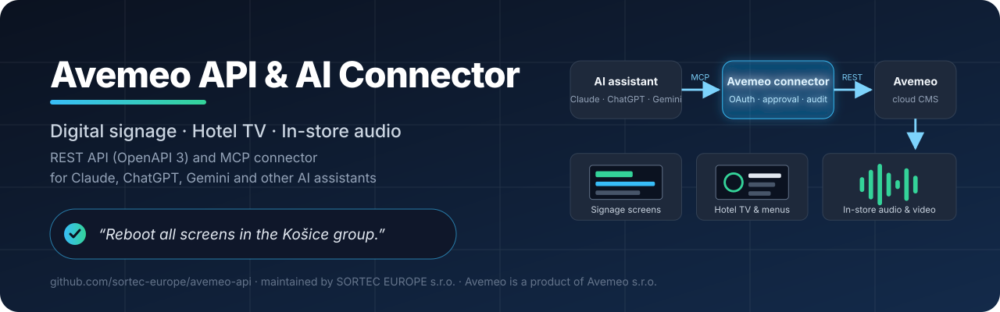
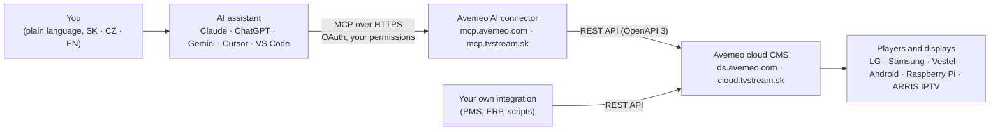

<!-- markdownlint-disable MD033 MD041 -->
<p align="center">
  <a href="https://github.com/sortec-europe/avemeo-api">
    
  </a>
</p>

# Avemeo API & AI Connector (MCP) – Digital Signage, Hotel TV and In-Store Audio

**Avemeo** is a cloud platform for **digital signage**, **hotel TV (hospitality IPTV)** and **in-store audio and video**. This repository is the public home of the **Avemeo REST API documentation** and the **Avemeo AI connector** – a remote [Model Context Protocol (MCP)](https://modelcontextprotocol.io) server that lets you manage screens, playlists, schedules and players in plain language from **Claude, ChatGPT, Gemini** or any other MCP-compatible AI assistant.

<p>
  <a href="docs/mcp-connector.md"></a>
  <a href="docs/api-overview.md"></a>
  <a href="https://modelcontextprotocol.io"></a>
  <a href="LICENSE"></a>
  <a href="README.sk.md"></a>
  <a href="README.cs.md"></a>
  
</p>

> 🇸🇰 **Slovenská verzia:** [README.sk.md](README.sk.md) · 🇨🇿 **Česká verze:** [README.cs.md](README.cs.md) · 📄 **Machine-readable summary for AI tools:** [llms.txt](llms.txt)

## Table of contents

- [At a glance](#at-a-glance)
- [Who this is for](#who-this-is-for)
- [What is Avemeo?](#what-is-avemeo)
- [How the AI connector works](#how-the-ai-connector-works)
- [What you can say to your AI assistant](#what-you-can-say-to-your-ai-assistant)
- [Platform features](#platform-features)
- [Supported players and displays](#supported-players-and-displays)
- [Quick start: REST API](#quick-start-rest-api)
- [Quick start: AI connector (MCP)](#quick-start-ai-connector-mcp)
- [Security and control](#security-and-control)
- [Status and roadmap](#status-and-roadmap)
- [Frequently asked questions](#frequently-asked-questions)
- [Documentation](#documentation)
- [Contact and pilot program](#contact-and-pilot-program)
- [About this repository](#about-this-repository)

## At a glance

| | |
|---|---|
| **Product** | Avemeo – cloud CMS for digital signage, hotel TV and in-store audio/video |
| **Clouds** | Avemeo (`ds.avemeo.com`) · [Business Stream](https://www.telekom.sk/biznis/stredne-velke-firmy/business-stream) by Slovak Telekom (`cloud.tvstream.sk`) |
| **REST API** | OpenAPI 3 specification, 380+ operations, the same API the Avemeo CMS uses → [API overview](docs/api-overview.md) |
| **AI connector (MCP)** | Remote MCP server with OAuth sign-in for Claude, ChatGPT, Gemini, Cursor, VS Code and other MCP clients → [Connector details](docs/mcp-connector.md) · **Status: in development, pilot with selected customers being prepared** |
| **AI assistant in the CMS** | Built-in assistant inside the Avemeo CMS for customers without their own AI tool · **Status: in development** |
| **Players** | LG (webOS), Samsung and Vestel displays · Android players · Raspberry Pi · ARRIS VIP4302 IPTV set-top boxes |
| **Languages** | Prompts in Slovak, Czech or English; multilingual on-screen content |
| **Maintainer** | [SORTEC EUROPE s.r.o.](#about-this-repository) – distributor and business & development partner of Avemeo in Slovakia |
| **Contact** | [avemeo@sortec.sk](mailto:avemeo@sortec.sk) · [avemeo.sk](https://avemeo.sk) |

## Who this is for

- **Retail chains and store operators** who run in-store music, spots and video campaigns across many locations and need proof of play per device.
- **Hotels and hospitality** that want interactive hotel TV with live channels, guest name and room, a services menu, Netflix, YouTube and Chromecast.
- **Companies, institutions and venues** with reception and lobby screens, congress wayfinding, digital menu boards, queue systems and kiosks.
- **Developers and system integrators** who want to connect Avemeo to a PMS, ERP, booking or marketing system through the REST API.
- **Anyone who already uses an AI assistant** (Claude, ChatGPT, Gemini, Cursor…) and wants to manage their screens by simply writing what should happen.

## What is Avemeo?

Avemeo is a cloud-based **digital signage CMS** (content management system) developed by **Avemeo s.r.o.** It manages what plays on screens, hotel TVs and audio players from a single web application:

- content is built in a **visual screen editor** with widgets, templates and multi-level interactive menus,
- playback is organised in **playlists** and **schedulers** (what plays when: weekdays, times, date ranges, public holidays),
- **devices** (players, displays, set-top boxes) are monitored and controlled remotely,
- **statistics** record what played where and when (proof of play).

Avemeo is operated in two clouds. The **Avemeo cloud** (`ds.avemeo.com`) is run by Avemeo s.r.o. **Business Stream** (`cloud.tvstream.sk`) is a digital signage and hotel TV service of **Slovak Telekom** that runs on the Avemeo platform. In Slovakia, Avemeo is sold, deployed and supported by **SORTEC EUROPE s.r.o.**, which also maintains this repository.

## How the AI connector works

The Avemeo AI connector is a **remote MCP server**. You add it to your AI assistant once, sign in with your Avemeo account (OAuth) and choose what the assistant may access. From then on the assistant can read your account, prepare changes and – after you approve each change – apply them through the Avemeo REST API.



Key properties:

| Property | How it works |
|---|---|
| **Your AI, your subscription** | You use the AI assistant you already pay for. Avemeo provides the connector; no custom development is needed. |
| **Your account, your permissions** | The assistant works only in the Avemeo account you sign in to, with the access level you grant (for example read only, playlists and schedulers, screens, devices). |
| **Approve before apply** | Every change is prepared first and shown as before/after. Nothing is saved until you approve it (two-step write). |
| **No deleting through AI** | Deleting content via the connector is not available. |
| **Audit log and undo** | Every call is recorded with the user and the AI client. Change history and restore are planned. |

## What you can say to your AI assistant

With the connector you will be able to write to your assistant, in Slovak, Czech or English:

- *"Add the new autumn offer to the reception playlist from Friday, 10 seconds per slide."*
- *"Which store players were offline yesterday during opening hours? Sort by hours lost."*
- *"Create an English version of the hotel TV menu and add a language switch."*
- *"Reboot all screens in the Košice group and tell me when they are playing again."*
- *"Show me what is playing right now in room 204."*
- *"Make a lobby playlist with the five presentation screens, 8 seconds each, weekdays 8:00–17:00."*

More scenarios for retail, hotels, offices and operations: [Use cases](docs/use-cases.md).

| Task | In the CMS today | With the AI connector |
|---|---|---|
| Add a spot to 40 store playlists | Open each playlist, add the item, set duration, save – 40 times | One sentence, one approval |
| Find yesterday's outages | Open device statistics one device at a time | Ask for a table sorted by hours lost |
| Translate a hotel TV menu | Copy every text field into a second language by hand | Ask for the English version and review the preview |
| Morning status report | Log in and check the device list | A scheduled task in your assistant sends it to you |

## Platform features

- **Digital signage** – visual screen editor with widgets (text, images, video, clock, weather, name days, RSS, apps), templates, playlists and time-based schedulers with weekdays, date ranges and public holidays.
- **Interactive screens** – multi-level menus controlled by a remote control or touch, multilingual content with a language switch.
- **Hotel TV (hospitality IPTV)** – live TV channels (HLS) with EPG, guest name and room number on screen, guest account and messages, check-in/check-out integration with hotel systems (PMS), Netflix, YouTube and Chromecast apps.
- **In-store audio and video** – music and spots on shuffle, campaigns per store or group, proof-of-play statistics per device, screen and media file with CSV export.
- **Device management** – power on/off, reload, reboot, volume, TV channel, screenshots, online/offline monitoring with e-mail and SMS alerts.
- **Self-service and more** – hotel kiosk, queue management (calling system), quizzes, digital menu boards, congress and event wayfinding.
- **Open REST API** – documented OpenAPI 3 specification for integrations and automation.

## Supported players and displays

| Platform | Typical use |
|---|---|
| **LG commercial displays (webOS)** | Hotel TV and signage without an external player |
| **Samsung commercial displays** | Hotel TV and signage without an external player |
| **Vestel displays** | Hotel TV and signage |
| **Android players and TVs** | Signage screens, menu boards, audio |
| **Raspberry Pi** | Low-cost signage and audio players |
| **ARRIS VIP4302 IPTV set-top boxes** | Hotel IPTV on any TV |

## Quick start: REST API

The Avemeo REST API is the same API the Avemeo CMS web application uses. It is described by an **OpenAPI 3** specification published on every Avemeo cloud at `https://<your-cloud>/backend/openapi/`.

```bash
BASE_URL=https://cloud.tvstream.sk/backend   # Business Stream – or https://ds.avemeo.com/backend for the Avemeo cloud

# 1. Sign in – the response is {"status":"success","data":{"accessToken":"…"}}
curl -s -X POST "$BASE_URL/api/auth/login" \
  -H "Content-Type: application/json" \
  -d '{"username":"YOUR_USER","password":"YOUR_PASSWORD"}'

# 2. List playlists of your account
curl -s -X POST "$BASE_URL/api/playlist" \
  -H "Authorization: Bearer $TOKEN" \
  -H "Active-Profile-Id: $ACCOUNT_ID" \
  -H "Content-Type: application/json" \
  -d '{"filter":{},"page_number":1,"page_size":100,"sort_field":"id","sort_order":"asc"}'
```

Authentication, main API areas (folders, media, screens, playlists, schedulers, devices, remote control, statistics) and more examples: **[docs/api-overview.md](docs/api-overview.md)**.

## Quick start: AI connector (MCP)

> **Status:** in development. A pilot with selected customers is being prepared – [contact us](#contact-and-pilot-program) to take part. The steps below describe the planned setup.

When the connector is available for your account, you add it to your AI assistant once:

1. Open the connector settings of your assistant (in Claude: **Customize → Connectors → Add custom connector**; in ChatGPT: custom connector in developer mode; in Gemini CLI, Cursor or VS Code: add a remote MCP server).
2. Enter the connector URL for your cloud:

   | Cloud | Connector URL (at launch) |
   |---|---|
   | Avemeo (`ds.avemeo.com`) | `https://mcp.avemeo.com/mcp` |
   | Business Stream by Slovak Telekom (`cloud.tvstream.sk`) | `https://mcp.tvstream.sk/mcp` |

3. Sign in with your Avemeo account (OAuth) and choose the account and the access level the assistant may use.

Supported assistants, planned tools, permissions and security details: **[docs/mcp-connector.md](docs/mcp-connector.md)**.

## Security and control

- **OAuth sign-in** on the Avemeo sign-in page – the AI assistant never sees your password.
- **Scoped access** – you choose the account and the access level (read only, media, playlists and schedulers, screens, publishing, devices). Access can be revoked at any time in Avemeo.
- **Two-step writes** – every change is shown for approval before it is saved; deleting through AI is not possible.
- **Audit log** – every call is recorded with the user and the AI client.
- **Prompt-injection protection** – content stored in Avemeo (names, texts) is treated as data, never as instructions for the assistant.
- **Responsible disclosure** – see [SECURITY.md](SECURITY.md).

## Status and roadmap

| Component | Status (November 2026) |
|---|---|
| Avemeo platform and CMS | ✅ In production on both clouds |
| REST API (OpenAPI 3) | ✅ Available to Avemeo customers on every cloud |
| AI connector (remote MCP server) | 🚧 In development – pilot with selected customers being prepared |
| AI assistant built into the Avemeo CMS | 🚧 In development |
| Change history and undo through AI | 📋 Planned |

Changes to this documentation are tracked in [CHANGELOG.md](CHANGELOG.md).

## Frequently asked questions

**What is Avemeo?**
Avemeo is a cloud platform (CMS) for digital signage, hotel TV and in-store audio and video, developed by Avemeo s.r.o. It runs on LG, Samsung and Vestel displays, Android players, Raspberry Pi and ARRIS IPTV set-top boxes.

**What is the difference between Avemeo and Business Stream?**
Business Stream is a digital signage and hotel TV service of Slovak Telekom. It runs on the Avemeo platform in its own cloud (`cloud.tvstream.sk`). The Avemeo cloud (`ds.avemeo.com`) is operated by Avemeo s.r.o. The API and the AI connector work the same way on both; only the URLs differ.

**Does Avemeo have a public API?**
Yes. Every Avemeo cloud publishes an OpenAPI 3 specification at `https://<your-cloud>/backend/openapi/`. It is the same API the CMS uses, with 380+ operations covering media, screens, playlists, schedulers, devices, remote control and statistics. You need an Avemeo account to use it. See [docs/api-overview.md](docs/api-overview.md).

**What is MCP and why does it matter?**
The Model Context Protocol (MCP) is an open standard that lets AI assistants use external tools and data sources. Because Avemeo exposes a remote MCP server, any MCP-compatible assistant – Claude, ChatGPT, Gemini CLI, Cursor, VS Code and others – can work with your Avemeo account without custom development.

**Which AI assistants are supported?**
Any assistant that supports remote MCP servers with OAuth sign-in. Claude (web, desktop, mobile), ChatGPT (custom connectors), Gemini CLI, Cursor and VS Code are the primary targets.

**Is the AI connector available now?**
It is in development. A pilot with selected customers is being prepared. Write to [avemeo@sortec.sk](mailto:avemeo@sortec.sk) if you want to take part.

**Can the AI delete my content or break my screens?**
Deleting through the connector is not available. Every change is prepared first and applied only after you approve it. Changes are recorded in the audit log; change history and undo are planned.

**Which languages can I use?**
You can write to the assistant in Slovak, Czech or English. On-screen content in Avemeo can be multilingual with a language switch.

**Do I need my own AI subscription?**
Yes – the connector plugs into the AI assistant and subscription you already have. For customers who do not use their own AI tool, the Avemeo team is building an AI assistant directly into the Avemeo CMS.

**Can I integrate Avemeo without AI?**
Yes. The REST API is independent of the AI connector and is used for integrations with hotel systems (PMS), ERP and marketing tools, and for automation scripts.

**Who maintains this repository?**
SORTEC EUROPE s.r.o., the distributor and business & development partner of Avemeo in Slovakia and a partner for Business Stream by Slovak Telekom. Avemeo is a product of Avemeo s.r.o.

More questions and answers: [docs/faq.md](docs/faq.md).

## Documentation

| Document | Content |
|---|---|
| [docs/api-overview.md](docs/api-overview.md) | REST API: authentication, main areas, paging, examples |
| [docs/mcp-connector.md](docs/mcp-connector.md) | AI connector (MCP): supported assistants, sign-in, planned tools, security, pilot |
| [docs/use-cases.md](docs/use-cases.md) | What you can do with Avemeo and an AI assistant – retail, hotels, offices, operations |
| [docs/faq.md](docs/faq.md) | Frequently asked questions |
| [docs/glossary.md](docs/glossary.md) | Glossary: digital signage, proof of play, MCP, scheduler, widget… |
| [docs/sk/](docs/sk/) · [docs/cs/](docs/cs/) | 🇸🇰 Slovak and 🇨🇿 Czech versions of the documentation |
| [marketing/](marketing/) | One-pagers (EN, SK, CS) and press release templates |
| [llms.txt](llms.txt) | Machine-readable summary of this repository for AI tools |
| [CHANGELOG.md](CHANGELOG.md) · [CONTRIBUTING.md](CONTRIBUTING.md) · [SECURITY.md](SECURITY.md) | Changes, how to contribute, how to report a security issue |

Found a mistake or have a question? [Open an issue](https://github.com/sortec-europe/avemeo-api/issues/new/choose).

## Contact and pilot program

- **Avemeo:** [avemeo.sk](https://avemeo.sk) · [avemeo@sortec.sk](mailto:avemeo@sortec.sk)
- **Sales, deployment, support and the AI pilot program (Slovakia):** **SORTEC EUROPE s.r.o.** – distributor and business & development partner of Avemeo, partner for [Business Stream](https://www.telekom.sk/biznis/stredne-velke-firmy/business-stream) by Slovak Telekom → [avemeo@sortec.sk](mailto:avemeo@sortec.sk)
- **Business Stream (Slovak Telekom):** [telekom.sk – Business Stream](https://www.telekom.sk/biznis/stredne-velke-firmy/business-stream)

Interested in testing the AI connector with your screens? Send a short note with your industry, number of devices and the AI assistant you use to [avemeo@sortec.sk](mailto:avemeo@sortec.sk).

## About this repository

This repository is maintained by **SORTEC EUROPE s.r.o.**, distributor and business & development partner of Avemeo and partner for [Business Stream](https://www.telekom.sk/biznis/stredne-velke-firmy/business-stream) by Slovak Telekom. **Avemeo** is a product of **Avemeo s.r.o.** **Business Stream** is a service of **Slovak Telekom, a.s.** Names and trademarks belong to their respective owners.

The documentation and marketing texts in this repository are licensed under [CC BY 4.0](LICENSE). Contributions are welcome – see [CONTRIBUTING.md](CONTRIBUTING.md).
