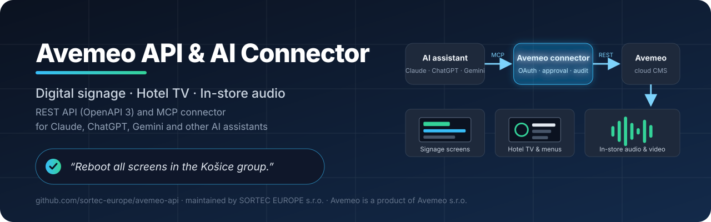
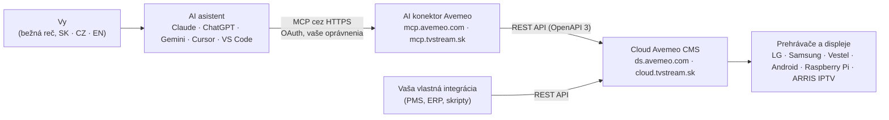

<!-- markdownlint-disable MD033 MD041 -->

  

# Avemeo API a AI konektor (MCP) – digital signage, hotelová TV a audio v predajniach

**Avemeo** je cloudová platforma pre **digital signage (digitálne obrazovky)**, **hotelovú TV (hotelová IPTV)** a **audio a video v predajniach**. Tento repozitár je verejným domovom **dokumentácie Avemeo REST API** a **AI konektora Avemeo** – vzdialeného servera [Model Context Protocol (MCP)](https://modelcontextprotocol.io), cez ktorý spravujete obrazovky, playlisty, časové plány a prehrávače bežnou rečou z **Claude, ChatGPT, Gemini** alebo iného AI asistenta s podporou MCP.

  
  
  
  
  
  
  

> 🇬🇧 **English version:** [README.md](README.md) · 🇨🇿 **Česká verze:** [README.cs.md](README.cs.md) · 📄 **Strojovo čitateľné zhrnutie pre AI nástroje:** [llms.txt](llms.txt)

## Obsah

- [V skratke](#v-skratke)
- [Pre koho je to určené](#pre-koho-je-to-určené)
- [Čo je Avemeo](#čo-je-avemeo)
- [Ako funguje AI konektor](#ako-funguje-ai-konektor)
- [Čo môžete AI asistentovi napísať](#čo-môžete-ai-asistentovi-napísať)
- [Funkcie platformy](#funkcie-platformy)
- [Podporované prehrávače a displeje](#podporované-prehrávače-a-displeje)
- [Rýchly štart: REST API](#rýchly-štart-rest-api)
- [Rýchly štart: AI konektor (MCP)](#rýchly-štart-ai-konektor-mcp)
- [Bezpečnosť a kontrola](#bezpečnosť-a-kontrola)
- [Stav a plán](#stav-a-plán)
- [Často kladené otázky](#často-kladené-otázky)
- [Dokumentácia](#dokumentácia)
- [Kontakt a pilotný program](#kontakt-a-pilotný-program)
- [O tomto repozitári](#o-tomto-repozitári)

## V skratke

| | |
|---|---|
| **Produkt** | Avemeo – cloudový CMS pre digital signage, hotelovú TV a audio/video v predajniach |
| **Cloudy** | Avemeo (`ds.avemeo.com`) · [Business Stream](https://www.telekom.sk/biznis/stredne-velke-firmy/business-stream) od Slovak Telekomu (`cloud.tvstream.sk`) |
| **REST API** | to isté API, ktoré používa Avemeo CMS; technická dokumentácia pre zákazníkov a integrátorov na požiadanie, pripravuje sa API v2 → [prehľad API](docs/sk/api-overview.md) |
| **AI konektor (MCP)** | vzdialený MCP server s prihlásením cez OAuth pre Claude, ChatGPT, Gemini, Cursor, VS Code a ďalších MCP klientov → [podrobnosti](docs/sk/mcp-connector.md) · **Stav: vo vývoji, pripravuje sa pilot s vybranými zákazníkmi** |
| **AI asistent v CMS** | asistent zabudovaný priamo v Avemeo CMS pre zákazníkov bez vlastného AI nástroja · **Stav: vo vývoji** |
| **Prehrávače** | displeje LG (webOS), Samsung a Vestel · prehrávače s Androidom · Raspberry Pi · IPTV set-top boxy ARRIS VIP4302 |
| **Jazyky** | pokyny po slovensky, česky alebo anglicky; viacjazyčný obsah na obrazovkách |
| **Správca repozitára** | [SORTEC EUROPE s.r.o.](#o-tomto-repozitári) – distribútor a obchodno-vývojový partner Avemeo na Slovensku |
| **Kontakt** | [avemeo@sortec.sk](mailto:avemeo@sortec.sk) · [avemeo.sk](https://avemeo.sk) |

## Pre koho je to určené

- **Retailové siete a prevádzkovatelia predajní**, ktorí púšťajú hudbu, spoty a video kampane v mnohých prevádzkach a potrebujú dôkaz o prehratí (proof of play) za každé zariadenie.
- **Hotely a ubytovacie zariadenia**, ktoré chcú interaktívnu hotelovú TV so živými kanálmi, menom hosťa a číslom izby, menu služieb, Netflixom, YouTube a Chromecastom.
- **Firmy, inštitúcie a podujatia** s obrazovkami na recepcii a v lobby, kongresovou navigáciou, digitálnym menu, vyvolávacím systémom a kioskami.
- **Vývojári a systémoví integrátori**, ktorí chcú prepojiť Avemeo s hotelovým systémom (PMS), ERP, rezervačným alebo marketingovým systémom cez REST API.
- **Každý, kto už používa AI asistenta** (Claude, ChatGPT, Gemini, Cursor…) a chce spravovať svoje obrazovky tak, že jednoducho napíše, čo sa má stať.

## Čo je Avemeo

Avemeo je cloudový **CMS pre digital signage** (systém na správu obsahu), ktorý vyvíja spoločnosť **Avemeo s.r.o.** Z jednej webovej aplikácie riadi, čo sa prehráva na obrazovkách, hotelových televízoroch a audio prehrávačoch:

- obsah sa tvorí vo **vizuálnom editore obrazoviek** s widgetmi, šablónami a viacúrovňovými interaktívnymi menu,
- prehrávanie sa organizuje v **playlistoch** a **plánovačoch** (čo kedy hrá: dni v týždni, časy, obdobia, sviatky),
- **zariadenia** (prehrávače, displeje, set-top boxy) sa monitorujú a ovládajú na diaľku,
- **štatistiky** zaznamenávajú, čo sa kde a kedy prehralo (proof of play).

Avemeo beží v dvoch cloudoch. **Cloud Avemeo** (`ds.avemeo.com`) prevádzkuje Avemeo s.r.o. **Business Stream** (`cloud.tvstream.sk`) je služba **Slovak Telekomu** pre digital signage a hotelovú TV, ktorá beží na platforme Avemeo. Na Slovensku Avemeo predáva, nasadzuje a podporuje **SORTEC EUROPE s.r.o.**, ktorá spravuje aj tento repozitár.

## Ako funguje AI konektor

AI konektor Avemeo je **vzdialený MCP server**. Do svojho AI asistenta ho pridáte raz, prihlásite sa svojím účtom Avemeo (OAuth) a zvolíte, k čomu má asistent prístup. Odvtedy môže asistent čítať vaše konto, pripravovať zmeny a – po vašom schválení každej zmeny – vykonať ich cez Avemeo REST API.

Kľúčové vlastnosti:

| Vlastnosť | Ako to funguje |
|---|---|
| **Vaša AI, vaše predplatné** | Používate AI asistenta, za ktorého už platíte. Avemeo dodáva konektor; vlastný vývoj nie je potrebný. |
| **Vaše konto, vaše oprávnenia** | Asistent pracuje len v konte Avemeo, do ktorého sa prihlásite, a s úrovňou prístupu, ktorú mu povolíte (napr. len čítanie, playlisty a plánovače, obrazovky, zariadenia). |
| **Najprv schváliť, potom uložiť** | Každá zmena sa najprv pripraví a ukáže ako pred/po. Nič sa neuloží, kým ju neschválite (dvojkrokový zápis). |
| **Žiadne mazanie cez AI** | Mazanie obsahu cez konektor nie je dostupné. |
| **Audit a vrátenie zmien** | Každé volanie sa zapisuje s používateľom a AI klientom. História zmien a obnovenie sú v pláne. |

## Čo môžete AI asistentovi napísať

S konektorom budete môcť asistentovi napísať po slovensky, česky alebo anglicky:

- *„Daj od piatku do playlistu recepcie novú jesennú ponuku, 10 sekúnd na snímku.“*
- *„Ktoré prehrávače v predajniach boli včera počas otváracích hodín offline? Zoraď podľa stratených hodín.“*
- *„Sprav anglickú verziu hotelového TV menu a pridaj prepínač jazyka.“*
- *„Reštartuj všetky obrazovky v skupine Košice a daj vedieť, keď zase hrajú.“*
- *„Čo práve hrá v izbe 204?“*
- *„Vytvor playlist pre lobby z piatich prezentačných obrazoviek po 8 sekúnd, v pracovné dni 8:00–17:00.“*

Ďalšie scenáre pre retail, hotely, firmy a prevádzku: [príklady použitia](docs/sk/use-cases.md).

| Úloha | V CMS dnes | S AI konektorom |
|---|---|---|
| Pridať spot do 40 playlistov predajní | Otvoriť každý playlist, pridať položku, nastaviť trvanie, uložiť – 40-krát | Jedna veta, jedno schválenie |
| Nájsť včerajšie výpadky | Otvárať štatistiky zariadení jedno po druhom | Vypýtať si tabuľku zoradenú podľa stratených hodín |
| Preložiť hotelové TV menu | Ručne prepísať každé textové pole do druhého jazyka | Vypýtať si anglickú verziu a skontrolovať náhľad |
| Ranný prehľad stavu | Prihlásiť sa a prejsť zoznam zariadení | Naplánovaná úloha v asistentovi vám ho pošle |

## Funkcie platformy

- **Digital signage** – vizuálny editor obrazoviek s widgetmi (text, obrázky, video, hodiny, počasie, meniny, RSS, aplikácie), šablóny, playlisty a časové plánovače s dňami v týždni, obdobiami a sviatkami.
- **Interaktívne obrazovky** – viacúrovňové menu ovládané diaľkovým ovládačom alebo dotykom, viacjazyčný obsah s prepínačom jazyka.
- **Hotelová TV (hotelová IPTV)** – živé TV kanály (HLS) s EPG, meno hosťa a číslo izby na obrazovke, účet hosťa a správy, napojenie check-in/check-out na hotelový systém (PMS), aplikácie Netflix, YouTube a Chromecast.
- **Audio a video v predajniach** – hudba a spoty v náhodnom poradí, kampane podľa predajní alebo skupín, štatistiky prehrávania (proof of play) po zariadeniach, obrazovkách a súboroch s exportom do CSV.
- **Správa zariadení** – zapnutie a vypnutie, obnovenie, reštart, hlasitosť, TV kanál, screenshoty, sledovanie online/offline s upozornením e-mailom a SMS.
- **Samoobsluha a ďalšie** – hotelový kiosk, vyvolávací systém, kvízy, digitálne menu, kongresová a eventová navigácia.
- **REST API** – integrácie a automatizácia pre zákazníkov a integrátorov (dokumentácia na požiadanie).

## Podporované prehrávače a displeje

| Platforma | Typické použitie |
|---|---|
| **Komerčné displeje LG (webOS)** | hotelová TV a signage bez externého prehrávača |
| **Komerčné displeje Samsung** | hotelová TV a signage bez externého prehrávača |
| **Displeje Vestel** | hotelová TV a signage |
| **Prehrávače a TV s Androidom** | obrazovky, digitálne menu, audio |
| **Raspberry Pi** | cenovo dostupné prehrávače pre signage a audio |
| **IPTV set-top boxy ARRIS VIP4302** | hotelová IPTV na ľubovoľnom televízore |

## Rýchly štart: REST API

Avemeo má REST API – to isté rozhranie, ktoré používa Avemeo CMS – pre médiá, obrazovky, playlisty, plánovače, zariadenia, diaľkové ovládanie a štatistiky. Technická dokumentácia (špecifikácia OpenAPI 3, autentifikácia, príklady) sa poskytuje **zákazníkom a integrátorom po prihlásení a na požiadanie**, nie verejne, pretože súčasné API bolo navrhnuté pre CMS. Pripravuje sa nové API v2 s vlastnou dokumentáciou.

Integrátori: napíšte na [avemeo@sortec.sk](mailto:avemeo@sortec.sk). Prehľad a typické integrácie: **[docs/sk/api-overview.md](docs/sk/api-overview.md)**.

## Rýchly štart: AI konektor (MCP)

> **Stav:** vo vývoji. Pripravuje sa pilot s vybranými zákazníkmi – ak sa chcete zapojiť, [ozvite sa](#kontakt-a-pilotný-program). Kroky nižšie opisujú plánované nastavenie.

Keď bude konektor pre vaše konto dostupný, pridáte ho do AI asistenta raz:

1. Otvorte nastavenia konektorov vo svojom asistentovi (v Claude: **Customize → Connectors → Add custom connector**; v ChatGPT: vlastný konektor v režime pre vývojárov; v Gemini CLI, Cursore alebo VS Code: pridať vzdialený MCP server).
2. Zadajte adresu konektora podľa vášho cloudu:

   | Cloud | Adresa konektora (pri spustení) |
   |---|---|
   | Avemeo (`ds.avemeo.com`) | `https://mcp.avemeo.com/mcp` |
   | Business Stream od Slovak Telekomu (`cloud.tvstream.sk`) | `https://mcp.tvstream.sk/mcp` |

3. Prihláste sa svojím účtom Avemeo (OAuth) a zvoľte konto a úroveň prístupu, ktorú smie asistent používať.

Podporovaní asistenti, plánované nástroje, oprávnenia a bezpečnosť: **[docs/sk/mcp-connector.md](docs/sk/mcp-connector.md)**.

## Bezpečnosť a kontrola

- **Prihlásenie cez OAuth** na prihlasovacej stránke Avemeo – AI asistent nikdy nevidí vaše heslo.
- **Obmedzený prístup** – vyberiete konto a úroveň prístupu (len čítanie, médiá, playlisty a plánovače, obrazovky, publikovanie, zariadenia). Prístup môžete kedykoľvek v Avemeo odvolať.
- **Dvojkrokový zápis** – každá zmena sa pred uložením ukáže na schválenie; mazanie cez AI nie je možné.
- **Audit** – každé volanie sa zapisuje s používateľom a AI klientom.
- **Ochrana pred prompt injection** – obsah uložený v Avemeo (názvy, texty) sa berie ako dáta, nikdy ako pokyny pre asistenta.
- **Zodpovedné nahlasovanie chýb** – pozrite [SECURITY.md](SECURITY.md).

## Stav a plán

| Súčasť | Stav (november 2026) |
|---|---|
| Platforma Avemeo a CMS | ✅ v prevádzke na oboch cloudoch |
| REST API | ✅ dostupné zákazníkom Avemeo a integrátorom (dokumentácia na požiadanie) · pripravuje sa API v2 |
| AI konektor (vzdialený MCP server) | 🚧 vo vývoji – pripravuje sa pilot s vybranými zákazníkmi |
| AI asistent zabudovaný v Avemeo CMS | 🚧 vo vývoji |
| História zmien a vrátenie cez AI | 📋 v pláne |

Zmeny v tejto dokumentácii sú v [CHANGELOG.md](CHANGELOG.md).

## Často kladené otázky

**Čo je Avemeo?**
Avemeo je cloudová platforma (CMS) pre digital signage, hotelovú TV a audio a video v predajniach od spoločnosti Avemeo s.r.o. Beží na displejoch LG, Samsung a Vestel, prehrávačoch s Androidom, Raspberry Pi a IPTV set-top boxoch ARRIS.

**Aký je rozdiel medzi Avemeo a Business Stream?**
Business Stream je služba Slovak Telekomu pre digital signage a hotelovú TV. Beží na platforme Avemeo vo vlastnom cloude (`cloud.tvstream.sk`). Cloud Avemeo (`ds.avemeo.com`) prevádzkuje Avemeo s.r.o. API aj AI konektor fungujú na oboch rovnako, líšia sa len adresy.

**Má Avemeo API?**
Áno. Avemeo má REST API – to isté, ktoré používa CMS – pre médiá, obrazovky, playlisty, plánovače, zariadenia, diaľkové ovládanie a štatistiky. Technická dokumentácia sa poskytuje zákazníkom a integrátorom po prihlásení a na požiadanie; nie je verejná. Pripravuje sa nové API v2 s vlastnou dokumentáciou. Pozrite [docs/sk/api-overview.md](docs/sk/api-overview.md).

**Čo je MCP a prečo je dôležité?**
Model Context Protocol (MCP) je otvorený štandard, cez ktorý AI asistenti používajú externé nástroje a zdroje dát. Keďže Avemeo poskytuje vzdialený MCP server, môže s vaším kontom Avemeo pracovať ktorýkoľvek asistent s podporou MCP – Claude, ChatGPT, Gemini CLI, Cursor, VS Code a ďalšie – bez vlastného vývoja.

**Ktorí AI asistenti sú podporovaní?**
Každý asistent, ktorý podporuje vzdialené MCP servery s prihlásením cez OAuth. Hlavnými cieľmi sú Claude (web, desktop, mobil), ChatGPT (vlastné konektory), Gemini CLI, Cursor a VS Code.

**Je AI konektor už dostupný?**
Je vo vývoji. Pripravuje sa pilot s vybranými zákazníkmi. Ak sa chcete zapojiť, napíšte na [avemeo@sortec.sk](mailto:avemeo@sortec.sk).

**Môže AI zmazať môj obsah alebo pokaziť obrazovky?**
Mazanie cez konektor nie je dostupné. Každá zmena sa najprv pripraví a vykoná až po vašom schválení. Zmeny sa zapisujú do auditu; história zmien a vrátenie sú v pláne.

**V akých jazykoch môžem písať?**
Asistentovi môžete písať po slovensky, česky alebo anglicky. Obsah na obrazovkách v Avemeo môže byť viacjazyčný s prepínačom jazyka.

**Potrebujem vlastné predplatné AI?**
Áno – konektor sa pripája k AI asistentovi a predplatnému, ktoré už máte. Pre zákazníkov bez vlastného AI nástroja pripravuje tím Avemeo AI asistenta priamo v Avemeo CMS.

**Môžem Avemeo integrovať aj bez AI?**
Áno. REST API je nezávislé od AI konektora a používa sa na integrácie s hotelovými systémami (PMS), ERP a marketingovými nástrojmi aj na automatizačné skripty.

**Kto spravuje tento repozitár?**
SORTEC EUROPE s.r.o., distribútor a obchodno-vývojový partner Avemeo na Slovensku a partner pre Business Stream od Slovak Telekomu. Avemeo je produkt spoločnosti Avemeo s.r.o.

Ďalšie otázky a odpovede: [docs/sk/faq.md](docs/sk/faq.md).

## Dokumentácia

| Dokument | Obsah |
|---|---|
| [docs/sk/api-overview.md](docs/sk/api-overview.md) | REST API: kto ho môže používať, typické integrácie, API v2 |
| [docs/sk/mcp-connector.md](docs/sk/mcp-connector.md) | AI konektor (MCP): podporovaní asistenti, prihlásenie, plánované nástroje, bezpečnosť, pilot |
| [docs/sk/use-cases.md](docs/sk/use-cases.md) | Čo urobíte s Avemeo a AI asistentom – retail, hotely, firmy, prevádzka |
| [docs/sk/faq.md](docs/sk/faq.md) | Často kladené otázky |
| [docs/sk/glossary.md](docs/sk/glossary.md) | Slovník pojmov: digital signage, proof of play, MCP, plánovač, widget… |
| [docs/](docs/) · [docs/cs/](docs/cs/) | 🇬🇧 anglické a 🇨🇿 české verzie dokumentácie |
| [marketing/](marketing/) | One-pagery (SK, CS, EN) a šablóny tlačovej správy |
| [llms.txt](llms.txt) | Strojovo čitateľné zhrnutie repozitára pre AI nástroje |
| [CHANGELOG.md](CHANGELOG.md) · [CONTRIBUTING.md](CONTRIBUTING.md) · [SECURITY.md](SECURITY.md) | Zmeny, ako prispieť, ako nahlásiť bezpečnostný problém |

Našli ste chybu alebo máte otázku? [Založte issue](https://github.com/sortec-europe/avemeo-api/issues/new/choose).

## Kontakt a pilotný program

- **Avemeo:** [avemeo.sk](https://avemeo.sk) · [avemeo@sortec.sk](mailto:avemeo@sortec.sk)
- **Predaj, nasadenie, podpora a pilotný program AI (Slovensko):** **SORTEC EUROPE s.r.o.** – distribútor a obchodno-vývojový partner Avemeo, partner pre [Business Stream](https://www.telekom.sk/biznis/stredne-velke-firmy/business-stream) v Slovak Telekom → [avemeo@sortec.sk](mailto:avemeo@sortec.sk)
- **Business Stream (Slovak Telekom):** [telekom.sk – Business Stream](https://www.telekom.sk/biznis/stredne-velke-firmy/business-stream)

Chcete AI konektor vyskúšať na svojich obrazovkách? Pošlite krátku správu s odvetvím, počtom zariadení a AI asistentom, ktorý používate, na [avemeo@sortec.sk](mailto:avemeo@sortec.sk).

## O tomto repozitári

Repozitár spravuje **SORTEC EUROPE s.r.o.**, distribútor a obchodno-vývojový partner Avemeo a partner pre [Business Stream](https://www.telekom.sk/biznis/stredne-velke-firmy/business-stream) v Slovak Telekom. **Avemeo** je produkt spoločnosti **Avemeo s.r.o.** **Business Stream** je služba spoločnosti **Slovak Telekom, a.s.** Názvy a ochranné známky patria ich vlastníkom.

Dokumentácia a marketingové texty v tomto repozitári sú poskytované pod licenciou [CC BY 4.0](LICENSE). Príspevky sú vítané – pozrite [CONTRIBUTING.md](CONTRIBUTING.md).
