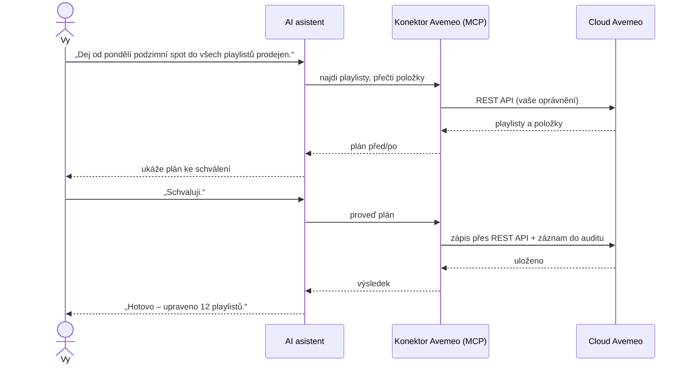

# AI konektor Avemeo (MCP) – správa digital signage a hotelové TV z Claude, ChatGPT nebo Gemini

> 🇬🇧 English version: [../mcp-connector.md](../mcp-connector.md) · 🇸🇰 Slovenská verzia: [../sk/mcp-connector.md](../sk/mcp-connector.md) · ⬅ Zpět na [README](../../README.cs.md)

> **Stav: ve vývoji.** Připravuje se pilot s vybranými zákazníky. Tato stránka popisuje plánovanou funkčnost a při spuštění bude aktualizována. Máte zájem o pilot? Napište na [avemeo@sortec.sk](mailto:avemeo@sortec.sk).

**AI konektor Avemeo** je vzdálený server **[Model Context Protocol (MCP)](https://modelcontextprotocol.io)**. Umožňuje AI asistentovi pracovat s účtem Avemeo jménem přihlášeného uživatele: najít a přečíst obrazovky, playlisty, plánovače, média a zařízení, připravit změny a po schválení uživatelem je provést. Zákazník používá **vlastního AI asistenta a vlastní předplatné**; Avemeo dodává konektor.

## Co je MCP

Model Context Protocol je otevřený standard, který v roce 2024 představila společnost Anthropic a dnes ho podporují hlavní AI asistenti i vývojářské nástroje. Popisuje, jak se AI asistent připojuje k externím **nástrojům** a **datům**. *Vzdálený MCP server* je takové připojení provozované na internetu: asistent s ním komunikuje přes HTTPS, uživatel se přihlásí přes OAuth a server nabízí sadu nástrojů, které asistent může volat.

Pro zákazníky Avemeo to znamená:

- **žádný vlastní vývoj** – konektor použije kterýkoli asistent s podporou MCP,
- **jeden konektor pro všechny asistenty** – Claude, ChatGPT, Gemini, Cursor, VS Code a další,
- **asistent zůstává váš** – data jdou přes vašeho asistenta podle podmínek vašeho poskytovatele AI; Avemeo jen poskytuje nástroje.

## Jak to funguje

1. **Čtení** – asistent čtecími nástroji najde a prohlédne to, na co se ptáte.
2. **Plán** – při každé změně konektor připraví plán a vrátí shrnutí před/po.
3. **Schválení** – asistent vám plán ukáže. Zatím se nic neuložilo.
4. **Provedení** – po vašem schválení se plán provede přes Avemeo REST API a zapíše do auditu.

## Podporovaní AI asistenti

Kterýkoli asistent s podporou **vzdálených MCP serverů s přihlášením přes OAuth**, například:

| Asistent | Jak připojit |
|---|---|
| **Claude** (web, desktop, mobil) | **Customize → Connectors → Add custom connector** → zadat adresu konektoru → přihlásit se. Na plánech Team a Enterprise přidá konektor jednou vlastník organizace; členové se přihlašují každý sám. |
| **ChatGPT** | Vlastní konektor (režim pro vývojáře) s přihlášením přes OAuth. |
| **Gemini CLI** | Přidat vzdálený MCP server s adresou konektoru. |
| **Cursor, VS Code (GitHub Copilot), Windsurf a další MCP klienti** | Přidat vzdálený MCP server s adresou konektoru. |

Adresa konektoru (při spuštění) podle vašeho cloudu:

| Cloud | Adresa konektoru |
|---|---|
| Avemeo (`ds.avemeo.com`) | `https://mcp.avemeo.com/mcp` |
| [Business Stream](https://www.telekom.sk/biznis/stredne-velke-firmy/business-stream) od Slovak Telekomu (`cloud.tvstream.sk`) | `https://mcp.tvstream.sk/mcp` |

## Přihlášení a oprávnění

- Přihlášení probíhá přes **OAuth** na přihlašovací stránce Avemeo. AI asistent **nikdy nevidí vaše heslo**.
- Vyberete **účet** a **úroveň přístupu**, například: jen čtení · média · playlisty a plánovače · obrazovky · publikování · zařízení.
- **Mazání** obsahu přes AI není dostupné.
- Přístup můžete **kdykoli odvolat** v Avemeo; asistent okamžitě ztratí spojení.
- Každý uživatel se přihlašuje vlastním účtem Avemeo, takže každá akce je v auditu přiřazena konkrétní osobě.

## Plánované schopnosti a nástroje

Názvy nástrojů jsou orientační a do spuštění se mohou změnit.

| Schopnost | Příklady nástrojů | Co asistent dokáže |
|---|---|---|
| **Hledání** | `list_folders`, `search` | Najít obrazovky, playlisty, média, plánovače a zařízení podle názvu nebo složky |
| **Média** | `list_media`, `upload_media` | Prohlížet knihovnu médií; nahrát obrázky, video a audio |
| **Playlisty** | `get_playlist`, `plan_playlist_change`, `apply_change` | Ukázat playlist; navrhnout změnu (přidat, odebrat, přesunout, trvání, platnost) s náhledem před/po; po schválení provést |
| **Plánovače** | `get_scheduler`, `plan_scheduler_change` | Ukázat, co kdy hraje; navrhnout změny rozvrhu s náhledem |
| **Obrazovky** | `create_from_template`, `plan_screen_change`, `preview_screen` | Vytvořit obrazovku nebo interaktivní menu ze šablony Avemeo s vašimi texty, obrázky a jazyky; upravit texty, polohy a widgety; vykreslit náhled |
| **Zařízení** | `list_devices`, `device_status`, `device_command` | Stav zařízení, co právě hraje, zapnutí/vypnutí, obnovení, restart |
| **Reporty** | `playback_report` | Proof of play a čas offline po zařízeních a dnech |
| **Historie** | `list_versions`, `restore_version` | Historie změn a vrácení |

Zápisy jdou vždy přes plán, který schvalujete. Přístup jen pro čtení je samostatná úroveň oprávnění pro uživatele, kteří se mají jen ptát.

## Příklad konverzace

> **Vy:** Které přehrávače v prodejnách byly včera během otevírací doby offline?
>
> **Asistent:** Zkontroloval jsem 42 přehrávačů. 39 hrálo celý den. Tři měly výpadky během otevírací doby:
> | Prodejna | Offline | Ztracené hodiny |
> |---|---|---|
> | Brno – Hlavní | 9:12–11:40 | 2,5 |
> | Olomouc | 14:05–14:30 | 0,4 |
> | Ostrava | 17:50–18:00 | 0,2 |
> Brno má opakované ranní výpadky čtyři ze sedmi dní – takový vzor obvykle ukazuje na síť v prodejně, ne na přehrávač.
>
> **Vy:** Restartuj brněnský přehrávač a dej vědět, až zase hraje.
>
> **Asistent:** Plán: restart zařízení *Brno – Hlavní* (ID 2081). Schvalujete?
>
> **Vy:** Schvaluji.
>
> **Asistent:** Restart odeslán. Přehrávač hlásil *hraje* za 48 sekund.

## Bezpečnost

- **Dvoukrokový zápis** – každá změna se před uložením ukáže uživateli ke schválení.
- **Audit** – každé volání se zapisuje s uživatelem, AI klientem a časem.
- **Minimální oprávnění** – konektor pracuje jen s účtem a oprávněními zvolenými při přihlášení; bez mazání.
- **Ochrana před prompt injection** – obsah z Avemeo (názvy, texty, názvy médií) se bere jako data, ne jako pokyny pro asistenta.
- **Zálohy** – předchozí stav změněných objektů se uchovává, aby se změny daly obnovit.
- **Přenos** – pouze HTTPS; tokeny OAuth jsou vázané na konektor a dají se odvolat.
- Našli jste zranitelnost? Viz [SECURITY.md](../../SECURITY.md).

## Často kladené otázky

**Stojí konektor něco navíc?**
Cena a dostupnost budou oznámeny při spuštění. Účastníci pilotu dostanou informace individuálně.

**Která data účtu asistent vidí?**
Pouze účet, do kterého se přihlásíte, a pouze oblasti pokryté úrovní přístupu, kterou povolíte. Jiné účty Avemeo nevidí, i když k nim má váš uživatel v CMS přístup – pokud se do nich také nepřihlásíte.

**Používá se můj obsah k trénování AI modelů?**
Konektor posílá data asistentovi, kterého jste si zvolili. Jak s nimi asistent nakládá, určují podmínky a plán vašeho poskytovatele AI – firemní a podnikové plány hlavních poskytovatelů zpravidla trénování na zákaznických datech vylučují. Avemeo od vašeho asistenta nedostává nic jiného než volání nástrojů.

**Může to používat více lidí ve firmě?**
Ano. Každý si přidá konektor do svého asistenta (nebo ho na týmových plánech přidá jednou administrátor) a přihlásí se vlastním účtem Avemeo.

**Co když asistent udělá chybu?**
Změny se provedou až po schválení plánu a předchozí stav se uchovává. Historie změn a vrácení přes asistenta jsou v plánu.

**Dají se automatizovat reporty?**
Asistenti s podporou naplánovaných úloh (například Claude) umí spouštět pokyn jako *„každé ráno mi pošli zařízení, která byla včera offline“* podle rozvrhu přes konektor.

**Funguje to s AI asistentem zabudovaným v Avemeo CMS?**
Asistent v CMS, který je také ve vývoji, používá stejné nástroje jako tento konektor. Je určen zákazníkům, kteří nepoužívají vlastní AI nástroj.

## AI asistent v CMS

Tým Avemeo vyvíjí také AI asistenta přímo v Avemeo CMS, který používá stejné nástroje jako tento konektor. Každou změnu ukáže v CMS v náhledu a před uložením si vyžádá schválení. Stav: ve vývoji.

## Pilotní program

Chcete konektor vyzkoušet na svých obrazovkách? Pošlete krátkou zprávu s odvětvím, počtem zařízení a AI asistentem, který používáte, na [avemeo@sortec.sk](mailto:avemeo@sortec.sk).

## Související

- [Přehled REST API](api-overview.md) – API, na kterém konektor stojí
- [Příklady použití](use-cases.md) – retail, hotely, firmy, provoz
- [FAQ](faq.md) · [Slovník pojmů](glossary.md)
- [Specifikace Model Context Protocol](https://modelcontextprotocol.io)
