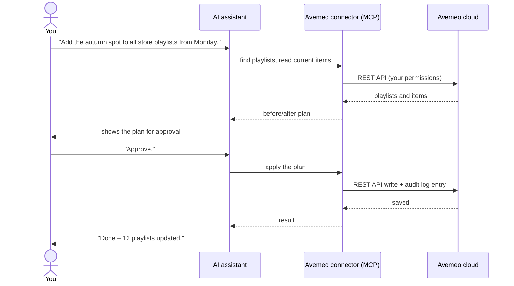

# Avemeo AI connector (MCP) – manage digital signage and hotel TV from Claude, ChatGPT or Gemini

> 🇸🇰 Slovenská verzia: [sk/mcp-connector.md](sk/mcp-connector.md) · ⬅ Back to [README](../README.md)

> **Status: in development.** A pilot with selected customers is being prepared. This page describes the planned functionality and will be updated at launch. Interested in the pilot? Write to [avemeo@sortec.sk](mailto:avemeo@sortec.sk).

The **Avemeo AI connector** is a remote **[Model Context Protocol (MCP)](https://modelcontextprotocol.io)** server. It lets an AI assistant work with an Avemeo account on behalf of a signed-in user: find and read screens, playlists, schedulers, media and devices, prepare changes, and apply them after the user approves. The customer uses **their own AI assistant and subscription**; Avemeo provides the connector.

## What is MCP?

The Model Context Protocol is an open standard, introduced by Anthropic in 2024 and now supported by the major AI assistants and developer tools, that describes how an AI assistant connects to external **tools** and **data**. A *remote MCP server* is such a connection hosted on the internet: the assistant talks to it over HTTPS, the user signs in with OAuth, and the server exposes a set of tools the assistant can call.

For Avemeo customers this means:

- **no custom development** – any MCP-compatible assistant can use the connector,
- **one connector for all assistants** – Claude, ChatGPT, Gemini, Cursor, VS Code and others,
- **the assistant stays yours** – data goes through your assistant under your AI provider's terms; Avemeo only provides the tools.

## How it works

1. **Read** – the assistant uses read tools to find and inspect what you ask about.
2. **Plan** – for any change, the connector prepares a plan and returns a before/after summary.
3. **Approve** – the assistant shows you the plan. Nothing is saved yet.
4. **Apply** – after you approve, the plan is applied through the Avemeo REST API and recorded in the audit log.

## Supported AI assistants

Any assistant that supports **remote MCP servers with OAuth sign-in**, for example:

| Assistant | How to connect |
|---|---|
| **Claude** (web, desktop, mobile) | **Customize → Connectors → Add custom connector** → enter the connector URL → sign in. On Team and Enterprise plans an organization owner adds the connector once; members sign in individually. |
| **ChatGPT** | Custom connector (developer mode) with OAuth sign-in. |
| **Gemini CLI** | Add a remote MCP server with the connector URL. |
| **Cursor, VS Code (GitHub Copilot), Windsurf and other MCP clients** | Add a remote MCP server with the connector URL. |

Connector URL (at launch), depending on your cloud:

| Cloud | Connector URL |
|---|---|
| Avemeo (`ds.avemeo.com`) | `https://mcp.avemeo.com/mcp` |
| [Business Stream](https://www.telekom.sk/biznis/stredne-velke-firmy/business-stream) by Slovak Telekom (`cloud.tvstream.sk`) | `https://mcp.tvstream.sk/mcp` |

## Sign-in and permissions

- Sign-in uses **OAuth** on the Avemeo sign-in page. The AI assistant **never sees your password**.
- You choose the **account** and the **access level**, for example: read only · media · playlists and schedulers · screens · publishing · devices.
- **Deleting** content through AI is not available.
- You can **revoke access at any time** in Avemeo; the assistant then loses the connection immediately.
- Each user signs in with their own Avemeo account, so every action is attributed to a person in the audit log.

## Planned capabilities and tools

Tool names are indicative and may change before launch.

| Capability | Example tools | What the assistant can do |
|---|---|---|
| **Find things** | `list_folders`, `search` | Find screens, playlists, media, schedulers and devices by name or folder |
| **Media** | `list_media`, `upload_media` | Browse the media library; upload images, video and audio |
| **Playlists** | `get_playlist`, `plan_playlist_change`, `apply_change` | Show a playlist; propose a change (add, remove, reorder, durations, validity) with a before/after preview; apply it after approval |
| **Schedulers** | `get_scheduler`, `plan_scheduler_change` | Show what plays when; propose schedule changes with a preview |
| **Screens** | `create_from_template`, `plan_screen_change`, `preview_screen` | Create a screen or interactive menu from an Avemeo template with your texts, images and languages; edit texts, positions and widgets; render a preview image |
| **Devices** | `list_devices`, `device_status`, `device_command` | Device status, what is playing now, power on/off, reload, reboot |
| **Reports** | `playback_report` | Proof of play and offline time per device and day |
| **History** | `list_versions`, `restore_version` | Change history and undo |

Writes always go through a plan that you approve. Read-only access is available as a separate permission level for users who should only ask questions.

## Example conversation

> **You:** Which store players were offline yesterday during opening hours?
>
> **Assistant:** I checked 42 players. 39 played the whole day. Three had outages during opening hours:
> | Store | Offline | Hours lost |
> |---|---|---|
> | Košice – Main Street | 9:12–11:40 | 2.5 |
> | Prešov | 14:05–14:30 | 0.4 |
> | Žilina | 17:50–18:00 | 0.2 |
> Košice shows repeated morning outages on four of the last seven days – that pattern usually points to the store network rather than the player.
>
> **You:** Reboot the Košice player and tell me when it is playing again.
>
> **Assistant:** Plan: reboot device *Košice – Main Street* (ID 2081). Approve?
>
> **You:** Approve.
>
> **Assistant:** Reboot sent. The player reported *playing* 48 seconds later.

## Security

- **Two-step writes** – every change is shown to the user for approval before it is saved.
- **Audit log** – every call is recorded with the user, the AI client and the time.
- **Least privilege** – the connector only works with the account and permissions chosen at sign-in; no deleting.
- **Prompt-injection protection** – content from Avemeo (names, texts, media titles) is treated as data, not as instructions to the assistant.
- **Backups** – the previous state of changed objects is kept so that changes can be restored.
- **Transport** – HTTPS only; OAuth tokens are scoped to the connector and can be revoked.
- Found a vulnerability? See [SECURITY.md](../SECURITY.md).

## Frequently asked questions

**Does the connector cost extra?**
Pricing and availability will be announced with the launch. Pilot participants are informed individually.

**Which account data does the assistant see?**
Only the account you sign in to and only the areas covered by the access level you grant. It never sees other Avemeo accounts, even if your user has access to them in the CMS, unless you sign in to those as well.

**Is my content used to train AI models?**
The connector sends data to the assistant you chose. How that assistant handles data is governed by your AI provider's terms and plan – business and enterprise plans of the major providers typically exclude training on customer data. Avemeo does not receive anything from your assistant other than the tool calls it makes.

**Can several people in my company use it?**
Yes. Each person adds the connector to their own assistant (or an admin adds it once on team plans) and signs in with their own Avemeo account.

**What if the assistant makes a mistake?**
Changes are only applied after you approve the plan, and the previous state is kept. Change history and undo through the assistant are planned.

**Can I automate reports?**
Assistants that support scheduled tasks (for example Claude) can run a prompt such as *"send me every morning the devices that were offline yesterday"* on a schedule using the connector.

**Does it work with the AI assistant built into the Avemeo CMS?**
The CMS assistant, also in development, uses the same tools as this connector. It is meant for customers who do not use their own AI tool.

## AI assistant in the CMS

The Avemeo team is also developing an AI assistant built directly into the Avemeo CMS, using the same tools as this connector. It will show a preview of every change in the CMS and ask for approval before saving. Status: in development.

## Pilot program

Interested in testing the connector with your screens? Send a short note with your industry, the number of devices and the AI assistant you use to [avemeo@sortec.sk](mailto:avemeo@sortec.sk).

## Related

- [REST API overview](api-overview.md) – the API behind the connector
- [Use cases](use-cases.md) – retail, hotels, offices, operations
- [FAQ](faq.md) · [Glossary](glossary.md)
- [Model Context Protocol specification](https://modelcontextprotocol.io)
