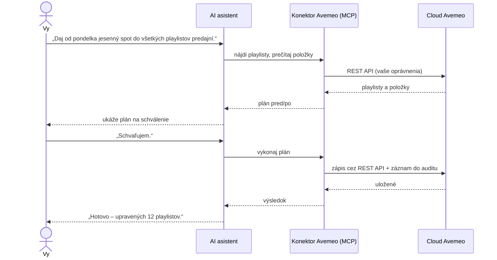

# AI konektor Avemeo (MCP) – správa digital signage a hotelovej TV z Claude, ChatGPT alebo Gemini

> 🇬🇧 English version: [../mcp-connector.md](../mcp-connector.md) · 🇨🇿 Česká verze: [../cs/mcp-connector.md](../cs/mcp-connector.md) · ⬅ Späť na [README](../../README.sk.md)

> **Stav: vo vývoji.** Pripravuje sa pilot s vybranými zákazníkmi. Táto stránka opisuje plánovanú funkčnosť a pri spustení bude aktualizovaná. Máte záujem o pilot? Napíšte na [avemeo@sortec.sk](mailto:avemeo@sortec.sk).

**AI konektor Avemeo** je vzdialený server **[Model Context Protocol (MCP)](https://modelcontextprotocol.io)**. Umožňuje AI asistentovi pracovať s kontom Avemeo v mene prihláseného používateľa: nájsť a prečítať obrazovky, playlisty, plánovače, médiá a zariadenia, pripraviť zmeny a po schválení používateľom ich vykonať. Zákazník používa **vlastného AI asistenta a vlastné predplatné**; Avemeo dodáva konektor.

## Čo je MCP

Model Context Protocol je otvorený štandard, ktorý v roku 2024 predstavila spoločnosť Anthropic a dnes ho podporujú hlavní AI asistenti aj vývojárske nástroje. Opisuje, ako sa AI asistent pripája k externým **nástrojom** a **dátam**. *Vzdialený MCP server* je takéto pripojenie prevádzkované na internete: asistent s ním komunikuje cez HTTPS, používateľ sa prihlási cez OAuth a server ponúka sadu nástrojov, ktoré asistent môže volať.

Pre zákazníkov Avemeo to znamená:

- **žiadny vlastný vývoj** – konektor použije ktorýkoľvek asistent s podporou MCP,
- **jeden konektor pre všetkých asistentov** – Claude, ChatGPT, Gemini, Cursor, VS Code a ďalší,
- **asistent ostáva váš** – dáta idú cez vášho asistenta podľa podmienok vášho poskytovateľa AI; Avemeo len poskytuje nástroje.

## Ako to funguje

1. **Čítanie** – asistent čítacími nástrojmi nájde a prezrie to, na čo sa pýtate.
2. **Plán** – pri každej zmene konektor pripraví plán a vráti zhrnutie pred/po.
3. **Schválenie** – asistent vám plán ukáže. Zatiaľ sa nič neuložilo.
4. **Vykonanie** – po vašom schválení sa plán vykoná cez Avemeo REST API a zapíše do auditu.

## Podporovaní AI asistenti

Ktorýkoľvek asistent s podporou **vzdialených MCP serverov s prihlásením cez OAuth**, napríklad:

| Asistent | Ako pripojiť |
|---|---|
| **Claude** (web, desktop, mobil) | **Customize → Connectors → Add custom connector** → zadať adresu konektora → prihlásiť sa. Na plánoch Team a Enterprise pridá konektor raz vlastník organizácie; členovia sa prihlasujú každý sám. |
| **ChatGPT** | Vlastný konektor (režim pre vývojárov) s prihlásením cez OAuth. |
| **Gemini CLI** | Pridať vzdialený MCP server s adresou konektora. |
| **Cursor, VS Code (GitHub Copilot), Windsurf a ďalší MCP klienti** | Pridať vzdialený MCP server s adresou konektora. |

Adresa konektora (pri spustení) podľa vášho cloudu:

| Cloud | Adresa konektora |
|---|---|
| Avemeo (`ds.avemeo.com`) | `https://mcp.avemeo.com/mcp` |
| [Business Stream](https://www.telekom.sk/biznis/stredne-velke-firmy/business-stream) od Slovak Telekomu (`cloud.tvstream.sk`) | `https://mcp.tvstream.sk/mcp` |

## Prihlásenie a oprávnenia

- Prihlásenie prebieha cez **OAuth** na prihlasovacej stránke Avemeo. AI asistent **nikdy nevidí vaše heslo**.
- Vyberiete **konto** a **úroveň prístupu**, napríklad: len čítanie · médiá · playlisty a plánovače · obrazovky · publikovanie · zariadenia.
- **Mazanie** obsahu cez AI nie je dostupné.
- Prístup môžete **kedykoľvek odvolať** v Avemeo; asistent okamžite stratí spojenie.
- Každý používateľ sa prihlasuje vlastným účtom Avemeo, takže každá akcia je v audite priradená konkrétnej osobe.

## Plánované schopnosti a nástroje

Názvy nástrojov sú orientačné a do spustenia sa môžu zmeniť.

| Schopnosť | Príklady nástrojov | Čo asistent dokáže |
|---|---|---|
| **Hľadanie** | `list_folders`, `search` | Nájsť obrazovky, playlisty, médiá, plánovače a zariadenia podľa názvu alebo priečinka |
| **Médiá** | `list_media`, `upload_media` | Prezerať knižnicu médií; nahrať obrázky, video a audio |
| **Playlisty** | `get_playlist`, `plan_playlist_change`, `apply_change` | Ukázať playlist; navrhnúť zmenu (pridať, odobrať, presunúť, trvanie, platnosť) s náhľadom pred/po; po schválení vykonať |
| **Plánovače** | `get_scheduler`, `plan_scheduler_change` | Ukázať, čo kedy hrá; navrhnúť zmeny rozvrhu s náhľadom |
| **Obrazovky** | `create_from_template`, `plan_screen_change`, `preview_screen` | Vytvoriť obrazovku alebo interaktívne menu zo šablóny Avemeo s vašimi textami, obrázkami a jazykmi; upraviť texty, polohy a widgety; vykresliť náhľad |
| **Zariadenia** | `list_devices`, `device_status`, `device_command` | Stav zariadení, čo práve hrá, zapnutie/vypnutie, obnovenie, reštart |
| **Reporty** | `playback_report` | Proof of play a čas offline po zariadeniach a dňoch |
| **História** | `list_versions`, `restore_version` | História zmien a vrátenie |

Zápisy idú vždy cez plán, ktorý schvaľujete. Prístup len na čítanie je samostatná úroveň oprávnení pre používateľov, ktorí sa majú len pýtať.

## Príklad konverzácie

> **Vy:** Ktoré prehrávače v predajniach boli včera počas otváracích hodín offline?
>
> **Asistent:** Skontroloval som 42 prehrávačov. 39 hralo celý deň. Tri mali výpadky počas otváracích hodín:
> | Predajňa | Offline | Stratené hodiny |
> |---|---|---|
> | Košice – Hlavná | 9:12–11:40 | 2,5 |
> | Prešov | 14:05–14:30 | 0,4 |
> | Žilina | 17:50–18:00 | 0,2 |
> Košice majú opakované ranné výpadky štyri zo siedmich dní – taký vzor zvyčajne ukazuje na sieť v predajni, nie na prehrávač.
>
> **Vy:** Reštartuj košický prehrávač a daj vedieť, keď zase hrá.
>
> **Asistent:** Plán: reštart zariadenia *Košice – Hlavná* (ID 2081). Schvaľujete?
>
> **Vy:** Schvaľujem.
>
> **Asistent:** Reštart odoslaný. Prehrávač hlásil *hrá* o 48 sekúnd.

## Bezpečnosť

- **Dvojkrokový zápis** – každá zmena sa pred uložením ukáže používateľovi na schválenie.
- **Audit** – každé volanie sa zapisuje s používateľom, AI klientom a časom.
- **Minimálne oprávnenia** – konektor pracuje len s kontom a oprávneniami zvolenými pri prihlásení; bez mazania.
- **Ochrana pred prompt injection** – obsah z Avemeo (názvy, texty, názvy médií) sa berie ako dáta, nie ako pokyny pre asistenta.
- **Zálohy** – predchádzajúci stav zmenených objektov sa uchováva, aby sa zmeny dali obnoviť.
- **Prenos** – iba HTTPS; tokeny OAuth sú viazané na konektor a dajú sa odvolať.
- Našli ste zraniteľnosť? Pozrite [SECURITY.md](../../SECURITY.md).

## Často kladené otázky

**Stojí konektor niečo navyše?**
Cena a dostupnosť budú oznámené pri spustení. Účastníci pilotu dostanú informácie individuálne.

**Ktoré dáta konta asistent vidí?**
Iba konto, do ktorého sa prihlásite, a iba oblasti pokryté úrovňou prístupu, ktorú povolíte. Iné kontá Avemeo nevidí, aj keď k nim má váš používateľ v CMS prístup – pokiaľ sa do nich tiež neprihlásite.

**Používa sa môj obsah na trénovanie AI modelov?**
Konektor posiela dáta asistentovi, ktorého ste si zvolili. Ako s nimi asistent nakladá, určujú podmienky a plán vášho poskytovateľa AI – firemné a podnikové plány hlavných poskytovateľov spravidla trénovanie na zákazníckych dátach vylučujú. Avemeo od vášho asistenta nedostáva nič iné než volania nástrojov.

**Môže to používať viac ľudí vo firme?**
Áno. Každý si pridá konektor do svojho asistenta (alebo ho na tímových plánoch pridá raz administrátor) a prihlási sa vlastným účtom Avemeo.

**Čo ak asistent urobí chybu?**
Zmeny sa vykonajú až po schválení plánu a predchádzajúci stav sa uchováva. História zmien a vrátenie cez asistenta sú v pláne.

**Dajú sa automatizovať reporty?**
Asistenti s podporou naplánovaných úloh (napríklad Claude) vedia spúšťať pokyn ako *„každé ráno mi pošli zariadenia, ktoré boli včera offline“* podľa rozvrhu cez konektor.

**Funguje to s AI asistentom zabudovaným v Avemeo CMS?**
Asistent v CMS, ktorý je tiež vo vývoji, používa rovnaké nástroje ako tento konektor. Je určený zákazníkom, ktorí nepoužívajú vlastný AI nástroj.

## AI asistent v CMS

Tím Avemeo vyvíja aj AI asistenta priamo v Avemeo CMS, ktorý používa rovnaké nástroje ako tento konektor. Každú zmenu ukáže v CMS na náhľad a pred uložením si vyžiada schválenie. Stav: vo vývoji.

## Pilotný program

Chcete konektor vyskúšať na svojich obrazovkách? Pošlite krátku správu s odvetvím, počtom zariadení a AI asistentom, ktorý používate, na [avemeo@sortec.sk](mailto:avemeo@sortec.sk).

## Súvisiace

- [Prehľad REST API](api-overview.md) – API, na ktorom konektor stojí
- [Príklady použitia](use-cases.md) – retail, hotely, firmy, prevádzka
- [FAQ](faq.md) · [Slovník pojmov](glossary.md)
- [Špecifikácia Model Context Protocol](https://modelcontextprotocol.io)
